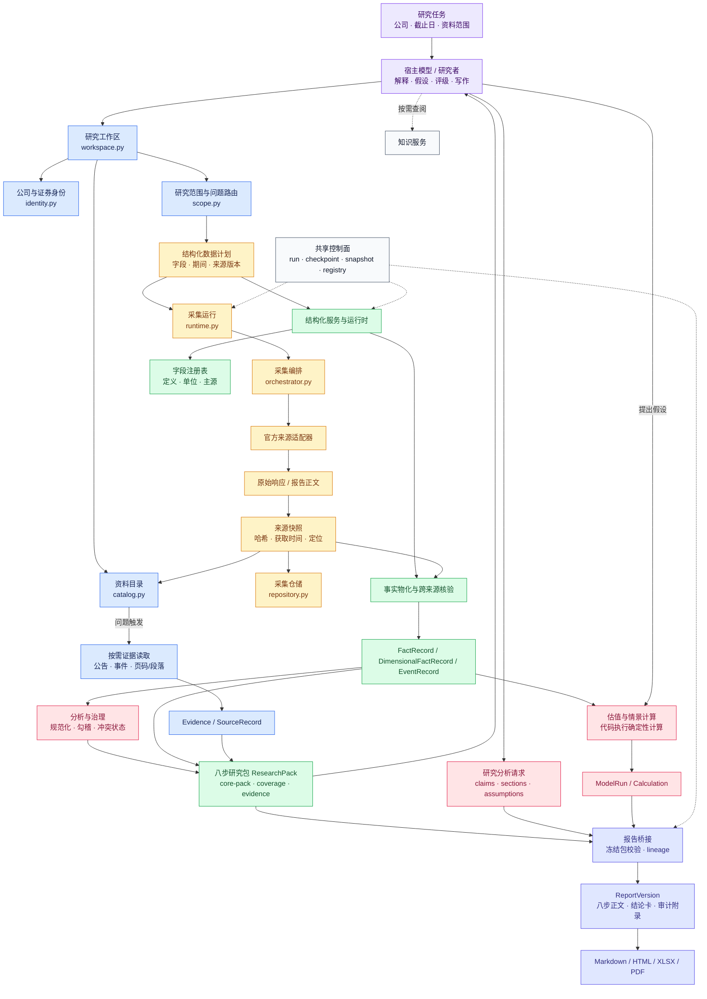

# 对象级数据流程

这张图描述一项公司研究从任务准备到报告导出的主要对象和边界。它补充 GitDiagram 的模块依赖图，重点回答“数据经过哪些阶段、在哪个阶段形成可追溯对象”。

实线表示研究数据或报告对象的主路径；虚线表示按需知识读取和共享控制面。`ResearchPack` 是模型读取结构化事实和证据的边界，`ReportVersion` 是报告导出前的版本化结果。

图中把宿主模型和代码职责分开：模型提出解释、假设、评级和写作内容；采集、快照、字段整理、确定性计算、血缘校验和多格式导出由代码完成。资料缺口、冲突和未确认假设沿对象状态进入研究包和报告，不通过补值隐藏。

这张图描述目标主链和当前代码中已经明确的对象边界。API、CLI、SQLite、DuckDB/Parquet 和前端属于运行承载层，未展开在业务数据流中。
